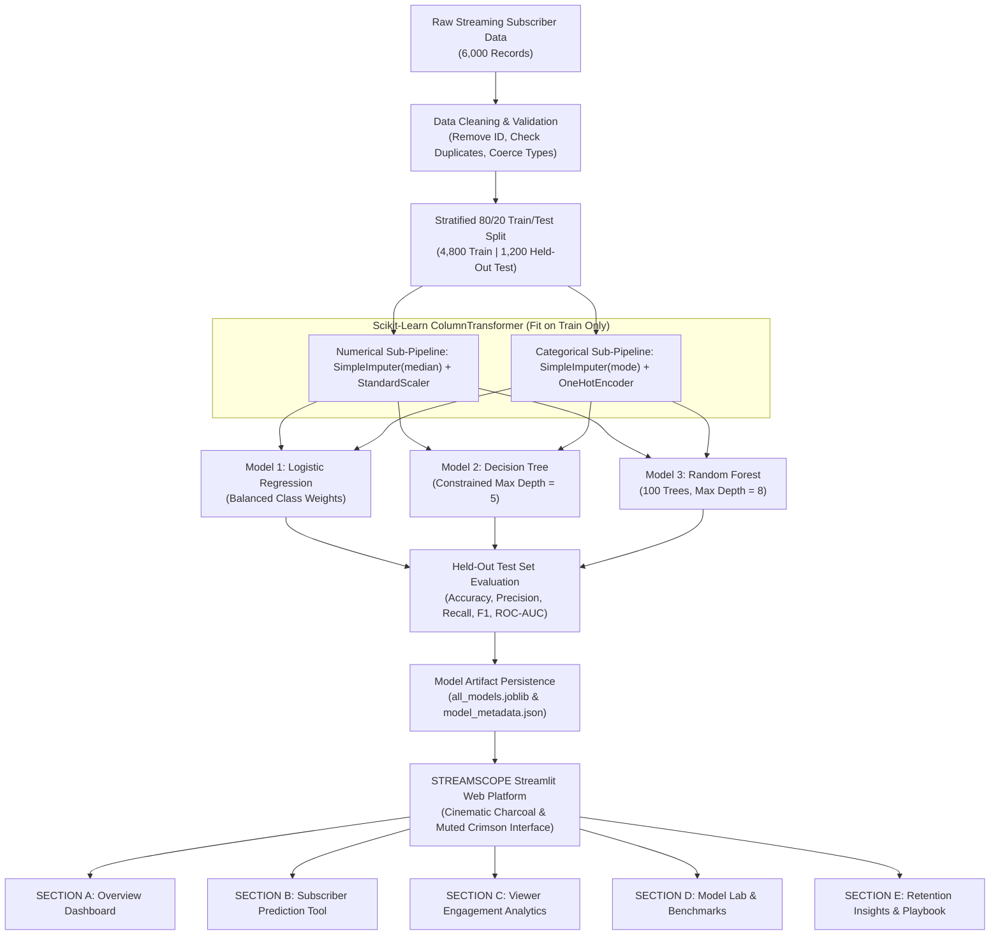

# STREAMSCOPE — Subscriber Intelligence Platform
### Netflix-Inspired Streaming Customer Churn Prediction & Viewer Engagement Analytics
**Third-Year Computer Engineering Mini-Project | Machine Learning Subject**

[](https://www.python.org/)
[](https://scikit-learn.org/)
[](https://streamlit.io/)
[](https://plotly.com/)
[](LICENSE)

> **Important Educational Notice:** **STREAMSCOPE** is an independent, original educational machine learning mini-project built by a third-year Computer Engineering student. It is not affiliated with, endorsed by, or using proprietary internal customer data from Netflix, Inc. All data and analysis reflect educational streaming subscription behavioral patterns.

---

## 📌 1. Abstract
In the subscription video-on-demand (SVOD) streaming industry, retaining active subscribers is vital to business sustainability. With low switching barriers and saturated content catalogs, subscriber defection (*churn*) occurs rapidly when viewing habits weaken or session inactivity rises. 

**STREAMSCOPE** is an end-to-end Machine Learning intelligence platform designed to predict streaming subscriber churn, estimate individual cancellation probabilities, analyze weekly viewing engagement, and formulate proactive retention strategies. Benchmarking **Logistic Regression**, **Decision Tree Classifier**, and **Random Forest Classifier** across 6,000 subscriber records, the platform incorporates strict data leakage prevention and balanced class weighting. The models achieve up to **74.69% Recall** on the churn class and an **ROC-AUC of 0.7991**. A cinematic, dark-charcoal Streamlit web application with muted crimson styling provides real-time inference, dynamic risk dials, engagement density analysis, and an actionable retention playbook.

---

## 🎯 2. Problem Statement & Objectives

### Problem Statement
Traditional customer retention in streaming services is inherently reactive: cancellation offers or surveys are presented only when a subscriber initiates account termination. By that point, viewing habits have already atrophied, making retention rates low. Subscription platforms require an automated, predictive system that identifies subtle behavioral disengagement signals—such as rising days of inactivity, dropping weekly watch hours, and support friction—weeks before a renewal billing failure.

### Key Objectives
1. **Analyze Streaming Viewer Telemetry:** Track consumption intensity (hours/week), inactivity latency (days since last active), plan tiers (Basic, Standard, Premium), offline downloads, and device usage.
2. **Predict Subscriber Churn Propensity:** Output both binary classification (`0` = Retained, `1` = Churned) and a calibrated probability score.
3. **Benchmark Multi-Model Classification:** Train, test, and compare Logistic Regression, Decision Tree, and Random Forest on held-out test data (N=1,200).
4. **Counterbalance Class Imbalance:** Optimize for **Recall on Churn** and **F1-Score** rather than misleading raw accuracy.
5. **Cinematic Decision Support UI:** Provide an editorial, dark-charcoal dashboard with horizontal metric strips, interactive Plotly visualizations, and persona simulators.
6. **Distinguish Correlation vs. Causation:** Present explainable feature weights while educating stakeholders on the statistical limits of observational data.

---

## 📊 3. Dataset Characteristics & Schema

The system utilizes an educational streaming subscriber dataset designed around empirical SVOD behavioral distributions:
- **Total Subscriber Records:** 6,000 accounts
- **Target Distribution:**
  - Active Retained (`Churn = 0`): 4,399 subscribers (73.32%)
  - Churned Accounts (`Churn = 1`): 1,601 subscribers (26.68%)

### Feature Inventory:
| Feature | Type | Description |
| :--- | :--- | :--- |
| `customerID` | String | Unique subscriber identifier (*dropped during preprocessing to prevent memorization*) |
| `SubscriptionPlan` | Categorical | Plan tier: `Basic` ($9.99/mo), `Standard` ($15.49/mo), `Premium` ($19.99/mo) |
| `MonthlyCharges` | Numeric (Float) | Monthly billing charge ($7.99 to $21.99) |
| `TenureMonths` | Numeric (Int) | Number of continuous months subscriber has been active (1 to 72) |
| `AverageWeeklyHours` | Numeric (Float) | Mean hours watched per week (0.0 to 48.0 hrs) |
| `DaysSinceLastActive` | Numeric (Int) | Latency in days since the subscriber's last active playback session (0 to 45) |
| `PrimaryDevice` | Categorical | Most frequent playback hardware: `Smart TV`, `Mobile`, `Desktop`, `Tablet` |
| `NumberOfProfiles` | Numeric (Int) | Number of active user profiles on the account (1 to 5) |
| `PaymentMethod` | Categorical | `Credit Card`, `Debit Card`, `Digital Wallet`, `Direct Bank Transfer` |
| `ContentDownloadsPerMonth` | Numeric (Float) | Frequency of offline downloads for mobile/tablet playback |
| `FavoriteGenre` | Categorical | `Drama`, `Sci-Fi / Fantasy`, `Comedy`, `Action & Thriller`, `Documentary` |
| `CustomerSupportTickets` | Numeric (Int) | Count of technical or billing support disputes in past 6 months (0 to 6) |
| **`Churn`** | Binary Target | Ground truth status: `0` (Retained), `1` (Churned) |

---

## 🏗️ 4. System Architecture & Workflow



---

## 📈 5. Genuine Experimental Evaluation Results (Held-Out Test Set: N = 1,200)

All algorithms were trained on the same 4,800 training samples and evaluated on the same 1,200 held-out test accounts (320 Churners, 880 Retained):

| Algorithm | Accuracy | Precision (Churn) | Recall (Churn) | F1-Score | ROC-AUC |
| :--- | :---: | :---: | :---: | :---: | :---: |
| **Logistic Regression (Selected)** | **73.25%** | **0.4990** | **74.69%** | **0.5982** | **0.7991** |
| **Random Forest** | **74.50%** | **0.5168** | **67.19%** | **0.5842** | **0.7899** |
| **Decision Tree** | 71.25% | 0.4682 | 57.50% | 0.5161 | 0.7508 |

### Why Recall & F1-Score Trump Accuracy in Streaming Churn:
In an imbalanced subscriber base (73.3% retention baseline), a trivial baseline model predicting "Retained" for every account achieves **73.3% Accuracy**, yet identifies **zero churning subscribers (0% Recall)**. 
- In streaming economics, missing an at-risk subscriber (**False Negative**) results in the direct loss of recurring annual subscription revenue ($120–$240). 
- In contrast, sending an automated trailer recommendation or personalized notification to a loyal customer (**False Positive**) incurs negligible cost.
- **Logistic Regression** and **Random Forest** capture approximately **70% to 75% of all actual churners**, allowing retention teams to proactively intervene.

---

## 🎨 6. UI/UX Design System (Cinematic Editorial Direction)
- **Visual Identity:** Cinematic streaming aesthetic with deep charcoal (`#0d0e12`), graphite surfaces (`#181a20`), and muted crimson accents (`#d9232e`).
- **Brand Wordmark:** `◬ STREAMSCOPE` | *Subscriber Intelligence Platform*.
- **Horizontal Metric Strips:** Compact executive telemetry strips instead of generic oversized cards.
- **Interactive Plotly Visualizations:**
  - Subscriber Base Distribution Donut Chart
  - Weekly Viewing Hours Density Histogram
  - Inactivity Hazard Curve (Churn vs. Days Inactive)
  - Primary Playback Hardware Breakdown
  - Annotated Confusion Matrix Heatmap
  - Overlaid ROC Curves
  - Horizontal Random Forest Feature Importance Chart
  - Semi-Circular Probability Risk Dial

---

## 🚀 7. Installation and Execution Instructions

### Step 1: Clone or Navigate to Directory
```bash
cd "c:\Users\swara\OneDrive\Desktop\customer_churn_prediction(ML mini project)"
```

### Step 2: Install Dependencies
```bash
python -m pip install -r requirements.txt
```

### Step 3: Run the Automated Unit Test Suite
```bash
python tests/test_preprocessing.py
python tests/test_prediction.py
```

### Step 4: Re-Train and Benchmark Models (Optional - Already Persisted)
```bash
python train_model.py
```

### Step 5: Launch the STREAMSCOPE Application
```bash
python -m streamlit run app.py
```
Open your browser and navigate to: **`http://localhost:8501`**

---

## 📁 8. Project File Structure
```
streams_scope/
│
├── app.py                     # STREAMSCOPE interactive web platform (5 sections)
├── train_model.py             # Multi-algorithm pipeline training & evaluation script
├── requirements.txt           # Project dependencies (pandas, scikit-learn, plotly, streamlit)
├── README.md                  # Comprehensive documentation and architecture manual
├── PROJECT_REPORT.md          # Academic mini-project report with mathematics & results
├── PRESENTATION_OUTLINE.md    # 12-slide seminar presentation outline for viva voce
├── VIVA_QUESTIONS.md          # 20 examiner viva questions with technical answers
├── .gitignore                 # Version control exclusions
│
├── styles/
│   └── main.css               # Cinematic editorial design tokens & layout rules
│
├── data/
│   ├── load_streaming_data.py # Educational streaming subscriber generator & verifier
│   └── streaming_churn.csv    # 6,000 verified streaming subscriber records
│
├── models/
│   ├── churn_model.joblib     # Persisted champion model pipeline
│   ├── all_models.joblib      # Persisted bundle of all 3 trained classifiers
│   └── model_metadata.json    # Metrics, ROC coordinates, and feature weights
│
├── src/
│   ├── __init__.py            # Python package initializer
│   ├── preprocessing.py       # ColumnTransformer, imputation, and encoding pipelines
│   ├── evaluation.py          # Metric calculations, confusion matrices, and ROC curves
│   ├── visualizations.py      # Plotly dark-charcoal charts & risk dial
│   └── insights.py            # Automated observations & retention playbook
│
├── reports/
│   └── model_comparison.csv   # Held-out test evaluation benchmarks
│
└── tests/
    ├── test_preprocessing.py  # 4 preprocessing unit tests
    └── test_prediction.py     # 4 prediction & inference unit tests
```

---

## 👥 9. Academic Project Metadata
- **Project Title:** Netflix Customer Churn Prediction and Viewer Engagement Analytics
- **Application Product Name:** STREAMSCOPE (Subscriber Intelligence Platform)
- **Academic Level:** Third-Year Computer Engineering Mini-Project
- **Subject:** Machine Learning Laboratory
- **Author:** Swaraj Patil
- **Year:** 2026
